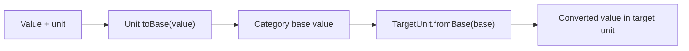
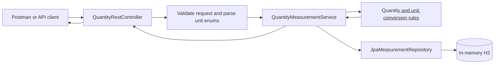
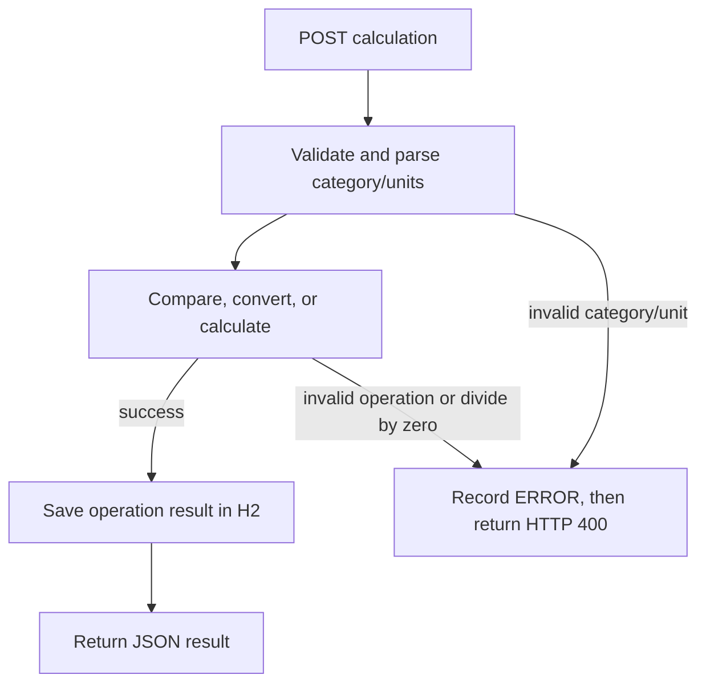

# Quantity Measurement App

A Java and Spring Boot learning project for comparing, converting, and calculating measurements. Each use case builds on the previous one. Application code is on [develop](https://github.com/Mihir-Lakhani/Bridgelabz-Quantity-Measurement-App/tree/develop); `main` contains this guide only.

## At a glance

| Item | Details |
| --- | --- |
| Language | Java 21 |
| Backend | Spring Boot 4.1.2, Spring MVC, validation |
| Data | Spring Data JPA with in-memory H2 |
| Main idea | One generic `Quantity<U>` class and unit enums |
| API base path | `/api/v1/quantities` |
| Default port | `8080` |
| Data lifetime | History disappears when the application stops |

## Use cases

Each UC has its own `feature/uc-*` branch from `develop` and was merged back with a non-fast-forward merge. The current `develop` branch shows the final Spring/JPA version; earlier UC branches show the intermediate learning stages.

| UC | Topic | What it adds |
| --- | --- | --- |
| 01 | Feet equality | Compare two measurements in feet |
| 02 | Inches equality | Compare inches and distinguish units |
| 03 | Generic length | Use a quantity class for length comparison |
| 04 | More length units | Add yards and centimeters |
| 05 | Conversion | Convert between length units |
| 06 | Addition | Add two length quantities |
| 07 | Target unit | Choose the unit of an addition result |
| 08 | Unit enum refactor | Keep conversion factors in the unit enum |
| 09 | Weight | Add weight equality, conversion, and arithmetic |
| 10 | Generic quantity | Use `IMeasurable` and `Quantity<U>` across categories |
| 11 | Volume | Add volume units and operations |
| 12 | Subtraction/division | Add both arithmetic operations |
| 13 | Shared arithmetic | Centralize addition, subtraction, and division rules |
| 14 | Temperature | Convert and compare Celsius and Fahrenheit |
| 15 | Layers | Separate controller, service, and persistence roles |
| 16 | JDBC | Store operation history with JDBC at this learning stage |
| 17 | REST and JPA | Expose HTTP endpoints and store history with Spring Data JPA |

All 17 use cases are implemented. UC16's JDBC approach remains on its branch; UC17's final application uses JPA.

## Supported units and rules

| Category | Units | Base unit used by code | Supported operations |
| --- | --- | --- | --- |
| Length | `FEET`, `INCHES`, `YARDS`, `CENTIMETERS` | Feet | Compare, convert, add, subtract, divide |
| Weight | `KILOGRAM`, `GRAM`, `POUND` | Kilogram | Compare, convert, add, subtract, divide |
| Volume | `LITRE`, `MILLILITRE`, `GALLON` | Litre | Compare, convert, add, subtract, divide |
| Temperature | `CELSIUS`, `FAHRENHEIT` | Celsius | Compare and convert |

Temperature arithmetic on absolute temperatures is rejected. Units in requests are case-insensitive. A binary operation needs two values and units from the same category.



For example, `12 INCHES` becomes `1 FEET`. Addition and subtraction convert both operands into the target unit before calculating. Division returns a number rather than a new quantity.

## Run locally

Requirements: Java 21 or newer and Maven, or IntelliJ IDEA's Maven tool window.

```bash
git switch develop
mvn spring-boot:run
```

The API runs at `http://localhost:8080`. H2 is in memory, so saved operation history is cleared when the application stops. Run tests with:

```bash
mvn test
```

## Request and code flow



| Code area | Responsibility |
| --- | --- |
| `Quantity<U>` | Holds a value and unit; comparison, conversion, and arithmetic |
| `IMeasurable` | Common conversion contract for unit enums |
| `LengthUnit`, `WeightUnit`, `VolumeUnit`, `TemperatureUnit` | Base-unit formulas and supported operations |
| `OperationRequest` | Validated JSON input for calculations |
| `QuantityRestController` | HTTP routes and category/unit parsing |
| `QuantityMeasurementService` | Calls calculations and saves operation history |
| `JpaMeasurementRepository` and `MeasurementEntity` | Persist and retrieve history |
| `ApiExceptionHandler` | Convert invalid input and arithmetic errors into HTTP 400 |

The final code keeps the calculation rules in the domain objects and uses the service for operation history.

## REST API

Base URL: `http://localhost:8080/api/v1/quantities`.

### Calculation endpoints

| Method | Path after base | Required fields | Response |
| --- | --- | --- | --- |
| POST | `/compare` | First and second quantities | `{"equal":true}` or `false` |
| POST | `/convert` | First quantity and `targetUnit` | `result` and `unit` |
| POST | `/add` | First and second quantities | `result` and `unit` |
| POST | `/add-with-target-unit` | First and second quantities; optional `targetUnit` | `result` and `unit` |
| POST | `/subtract` | First and second quantities | `result` and `unit` |
| POST | `/subtract-with-target-unit` | First and second quantities; optional `targetUnit` | `result` and `unit` |
| POST | `/divide` | First and second quantities | Numeric `result` |

The code accepts `targetUnit` on `/add` and `/subtract` too. If it is omitted, the first unit is used. Although the named target-unit routes exist, they also fall back to the first unit when `targetUnit` is absent.

### Request fields

| Field | Type | Needed for |
| --- | --- | --- |
| `category` | String: `LENGTH`, `WEIGHT`, `VOLUME`, `TEMPERATURE` | Every calculation |
| `firstValue` | Number | Every calculation |
| `firstUnit` | String | Every calculation |
| `secondValue` | Number | Compare, add, subtract, divide |
| `secondUnit` | String | Compare, add, subtract, divide |
| `targetUnit` | String | Convert; optional for add/subtract |

Example: add one foot and twelve inches.

```http
POST /api/v1/quantities/add
Content-Type: application/json

{
  "category": "LENGTH",
  "firstValue": 1,
  "firstUnit": "FEET",
  "secondValue": 12,
  "secondUnit": "INCHES"
}
```

Response:

```json
{"result":2.0,"unit":"FEET"}
```

Example: convert 100 Celsius to Fahrenheit.

```http
POST /api/v1/quantities/convert
Content-Type: application/json

{
  "category": "TEMPERATURE",
  "firstValue": 100,
  "firstUnit": "CELSIUS",
  "targetUnit": "FAHRENHEIT"
}
```

Response:

```json
{"result":212.0,"unit":"FAHRENHEIT"}
```

### History endpoints

| Method | Path after base | Result |
| --- | --- | --- |
| GET | `/history` | All saved operations |
| GET | `/history/operation/{operation}` | Only one operation, such as `ADD` |
| GET | `/history/type/{type}` | Records whose unit belongs to a category |
| GET | `/history/errored` | Rejected calculations recorded as `ERROR` |
| GET | `/count/{operation}` | Count of records for an operation |

A history item has `id`, `operation`, `result`, and `unit`. Comparison saves `1` for equal and `0` for unequal. The error history stores `result: 0` and the request's first unit when available; it does not store the original error message.



Invalid values, unknown units/categories, unsupported temperature arithmetic, and division by zero return HTTP `400` with an `error` message.

## Tests

`mvn test` runs unit tests for quantity calculations and HTTP tests for representative REST requests. The database used by the application is in memory, so no external database service is needed.
